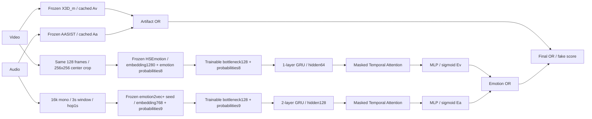

# FAV → FAV: frozen artifacts + GRU / Temporal Attention emotion flow

요청한 폴더 이름 `hierarchical_score_fusion_GRU_Temproal_Attention`의 철자를 그대로 사용한다. 이 실험은 새 FAV in-domain 실험이며, 기존 gated/variation 실험의 코드와 결과를 수정하지 않는다.

## 고정한 항목

- 기존 FAV X3D_m과 AASIST checkpoints, artifact 입력, 작동 방식과 분류기 점수를 유지한다.
- 완료된 `reports/artifact_emotion_gated_optimized_v1/cache/{video,audio}/{train,dev,test}`의 **원래 artifact_probability**를 그대로 사용한다. Gated head 점수를 artifact 점수로 사용하지 않는다.
- X3D_m: 전체 영상에서 균등한 128프레임, short side 256 / center crop 256×256, 원래 정규화 유지.
- AASIST: 16kHz mono, FAV 최대 길이 284,672 samples(17.792초)까지 오른쪽 0 패딩, 자르기 금지.
- 기존 fixed manifest, ID, source group, split, clip/video/audio label을 유지한다. Full FAV: train 14,724 / dev 3,147 / test 3,126.
- Artifact 모델을 다시 학습하거나 다시 순전파하지 않는다. 기존 완료 캐시·현재 checkpoint·ID/label/group·현재 파일의 크기/수정시간을 확인한다. 역사적 loader를 변경하지 않는다.

## 새 Emotion Flow



### HSEmotion 입력

사용자 확인에 따라 **얼굴 crop이 아닌 X3D_m과 같은 영상 center crop**을 사용한다. 동일한 프레임 인덱스와 동일한 256×256 RGB 픽셀 영역을 사용하되, HSEmotion의 pretrained 채널 정규화(mean 0.485/0.456/0.406, std 0.229/0.224/0.225)를 적용한다. 실제 HSE backbone 입력은 `[frame_batch,3,256,256]`이며, 기존 native 전처리의 Resize(224,224)를 호출하지 않는다.

영상이 128프레임 미만이면 X3D와 동일하게 일부 인덱스가 반복된다. 같은 프레임은 encoder에서 한 번 계산한 뒤 원래 128개 순서로 복원한다. 시간 순서와 timestamp를 저장하며 얼굴 검출에 의한 토큰 제외는 없다. Full-clip timestamp 확인과 선택 프레임 decode를 수행한다.

기존 HSE 얼굴 crop·224×224 cache와 입력 의미가 다르므로 **기존 영상 emotion embedding은 재사용하지 않는다**. 배치 추론 기본값은 32프레임이며, backbone은 eval/frozen/FP32다. 최종 pretrained 8-class 선형 분류기로 embedding에서 감정 확률을 함께 계산한다.

### emotion2vec+ seed 입력

기존과 동일한 원본 16kHz mono 음성에서 3초 완전한 window / hop1초를 사용한다. 3초보다 짧으면 패딩 없이 실제 음성 전체를 하나의 window로 처리한다. 3초 이상 음성의 마지막 불완전한 window는 따로 추가하지 않는다. 기존 encoder 내부 layer normalization과 utterance embedding을 유지한다.

이전 완료 캐시의 **window별 768차원 embedding, timestamp, valid mask**를 가져온다. 평균 embedding으로부터 시퀀스를 만들어내지 않는다. Native seed 구현은 window 내부 feature 평균 → pretrained Linear(768,9) → softmax를 사용하므로, 검증된 동일 checkpoint의 `model['proj.weight']`와 `model['proj.bias']`로 각 저장된 window embedding에서 감정 확률을 계산한다. NumPy/Torch 평균 연산의 작은 반올림 차이는 실제 encoder와의 비교 검증에서 확인한다.

HSE의 8개 감정과 seed의 9개 감정은 각 브랜치 안에서 독립적으로 사용한다. 클래스 간 의미를 강제로 같다고 간주하지 않으며 영상·음성 감정 확률을 직접 빼서 비교하지 않는다. ACRNN/CRNN은 사용하지 않는다.

### 학습되는 부분

각 유효 token의 embedding에 Linear(D,128) → BatchNorm1d → ReLU → Dropout(0.2)를 적용하고 native emotion probabilities를 연결한다. Padding은 BatchNorm 통계에 들어가지 않는다. 유효 token이 단 하나인 training batch는 BatchNorm의 running statistics를 사용한다.

- Video: 128+8=136차원 → 단방향 GRU 1층, hidden 64.
- Audio: 128+9=137차원 → 단방향 GRU 2층, hidden 128, 층간 dropout 0.2. Seed의 768차원을 줄이는 trainable bottleneck은 논문 초안의 CRNN을 교체하기 위한 명시적인 변경이다.
- `alpha_t = softmax(Linear(h_t))`, `context = sum(alpha_t * h_t)`.
- Context → Linear(hidden,64) → ReLU → Dropout(0.2) → Linear(64,1).
- Loss에는 raw logit, 점수에는 sigmoid를 사용한다.

유효 token을 시간순으로 유지하고 batch 안의 길이 차이는 packing/mask로 처리한다. 유효 token이 없는 샘플은 그 감정 head의 학습·dev 선택에서 제외한다. Token 1개는 attention weight가 1이고, 구간 간 변화에 관한 증거는 제공하지 않는다. Cache 완료 파일에 1-token 개수와 길이 분포를 기록한다. Timestamp는 보존하지만 경과 시간 자체를 GRU 입력에 추가하지는 않는다.

이 모델은 각 모달리티 내부의 시간적 감정 패턴과 조작 라벨의 관계를 학습한다. 별도의 영상-음성 cross-attention이나 consistency loss는 없다. 감정 흐름의 부자연스러움을 실제로 활용했는지는 mean-pooling/시간 순서 shuffle 등의 후속 대조실험으로 검증해야 하며, architecture만으로 입증되는 것은 아니다.

## Score fusion

```text
A = 1 - (1-Av)(1-Aa)       # Artifact Score Fusion
E = 1 - (1-Ev)(1-Ea)       # Emotion Score Fusion
Final = 1 - (1-A)(1-E)     # Final Score Fusion
```

최종적으로 `1-(1-Av)(1-Aa)(1-Ev)(1-Ea)`와 같다. 모든 threshold는 0.5로 고정한다. OR는 artifact 오탐을 낮출 수 없는 구조이므로 real FPR와 감정 점수의 편향도 함께 보고한다. 점수가 실제 확률로 보정되었다는 주장은 하지 않는다.

두 감정이 모두 관측된 동일 cohort를 primary로 사용하고, 전체 cohort 결과도 별도로 보고한다. Secondary에서는 누락된 감정 항만 OR에서 제외하며 CSV의 원래 emotion score는 빈칸으로 남긴다. 누락된 관측을 real 정답으로 취급하지 않는다. 현재 center-crop video에서는 decode 실패를 조용히 제외하지 않고 명시적으로 중단한다.

## 학습·평가 프로토콜

- HSEmotion, emotion2vec+ seed, X3D_m, AASIST는 frozen.
- Video emotion head는 `video_label`, audio emotion head는 `audio_label`로 **각각 학습**.
- 각 head의 best model은 **FAV dev 해당 모달리티 ROC-AUC**로 선택한다.
- 기본값: 20epoch, batch8, AdamW lr5e-4, weight decay1e-4, BCE pos_weight0.25, gradient clipping5, FP32. 두 head 모두 설정된 epoch를 수행하고 최고 dev 모델을 고른다.
- Base seed42; video42, audio43. Padding mask / 동일 seed resume를 검증한다.
- 두 head를 선택한 후 `LOCKED_BEFORE_TEST.json`으로 고정하고 test emotion 추출·평가를 수행한다.
- 기존 FAV test는 앞선 실험에서 이미 관찰했다. 이번은 새 temporal 모델의 후속 비교이며, 완전히 처음 공개하는 holdout으로 기술하지 않는다.

## 실행 명령어 — PowerShell, 프로젝트 루트

```powershell
$exp = './scripts/hierarchical_score_fusion_GRU_Temproal_Attention/experiment.py'
./scripts/run.ps1 $exp preflight

# 전체 FAV in-domain 실험
./scripts/run.ps1 $exp run `
  --output reports/hierarchical_score_fusion_gru_temporal_attention_fav_v1/seed_42 `
  --encoder-device cuda:0 --head-device cuda:0
```

기존처럼 `.venv/Scripts/python.exe`를 사용한다. 프로젝트 밖의 Python 환경이나 글로벌 라이브러리를 사용하지 않는다.

```powershell
# 중단 후: 기존과 같은 명령·설정·출력 폴더에 --resume만 추가
./scripts/run.ps1 $exp run `
  --output reports/hierarchical_score_fusion_gru_temporal_attention_fav_v1/seed_42 `
  --encoder-device cuda:0 --head-device cuda:0 --resume

# 별도 소규모 검증: 정식 결과로 사용하지 않음
./scripts/run.ps1 $exp run --smoke-limit 16 --epochs 2 `
  --output reports/hierarchical_score_fusion_gru_temporal_attention_validation_20261010/smoke `
  --encoder-device cuda:0 --head-device cuda:0

# 테스트
./scripts/run.ps1 -m unittest scripts.hierarchical_score_fusion_GRU_Temproal_Attention.test_experiment -v
```

GPU를 사용할 수 없으면 두 device를 cpu로 지정할 수 있지만 새 출력 폴더에서 시작한다. 실행 도중 frame batch, device, 모델 설정, 소스 코드 등을 바꾸어 같은 출력에 resume하지 않는다. `--prepare-only`는 train/dev cache 생성 후 멈춘다. 이후 같은 설정으로 `--prepare-only`를 빼고 `--resume`을 추가하면 학습부터 계속한다.

## 저장 및 재시작

- `RUN.json`: 입력·가중치·설정·구현 기록. 기존 source-workstation 해시를 새로 요구하는 것이 아니라 **이 실행의 캐시/weights 호환성**을 확인한다.
- `cache/{video,audio}/{train,dev,test}/samples.sqlite`: 샘플 단위로 atomic commit. Ctrl+C 이후 완료된 샘플은 유지된다.
- 같은 폴더의 `.npy`와 `index.npz`: 학습용 연속 배열 / memory mapping. Cache가 클 때 전체 embedding을 RAM에 한꺼번에 적재하지 않는다.
- `heads/{video,audio}/last.pt`: epoch 경계의 모델·optimizer·RNG·best model을 한 파일로 저장. 중간 epoch에서 끊으면 그 epoch만 다시 수행한다.
- `heads/{video,audio}/best.pt`, `history.json`, `COMPLETED.json`: dev 선택 결과와 history.
- `test/metrics.json`, `predictions.csv`: artifact/emotion/final OR와 브랜치 지표, coverage.
- `test/{video,audio}_attention.npz`: ID, offsets, 실제 timestamp, valid mask, temporal attention 가중치. Attention은 모델 내부 가중치이며 인과적 설명이라고 단정하지 않는다.
- `SUMMARY.json`, `timing.json`, root `COMPLETED.json`: 최종 결과. 이 root 완료 파일이 없으면 전체 실험 완료가 아니다.

영상 packed embedding의 순수 float32 용량은 전체 FAV 약13.76GB이고, 재시작용 SQLite도 별도로 보관한다. 초기 영상 추출이 주요 작업이다. 얼굴 검출과 X3D/AASIST/seed 재추론을 생략하지만 실제 처리 속도에 근거해 시간을 판단한다. 터미널에는 신규 추출 개수·기존 저장 개수·ETA, 각 epoch 진행률·loss·dev AUC·best epoch가 표시된다. ETA는 이미 저장된 샘플을 새 추출 속도에 섞지 않는다.

검증 결과와 실측은 별도 validation 폴더의 기록을 참고한다. Smoke 점수를 정식 성능으로 보고하지 않는다.

## 2026-10-10 구현 검증 및 첫 실행

- 단위 테스트 9개 통과: padding 무시, attention 정규화, 순서 민감성, GRU/attention gradient, OR 수식, split overlap 차단, 샘플 및 epoch 재시작 등.
- 실제 FAV train/dev/test 각16개, 두 head 각2epoch, CUDA에서 전체 pipeline 완료. 이 결과는 smoke-only다.
- Smoke test의 Av/Aa가 기존 artifact cache와 **정확히 동일**함을 확인했다.
- 실제 3초 음성 window를 seed encoder로 다시 계산했을 때 이전 embedding과 최대 절대오차0, embedding에서 복원한 감정 확률은 최대 절대오차 약1.16e-9였다.
- HSE 신규 영상 추출 및 cache pack은 48개 합계 약22.37초. 전체 FAV21,000개 수준으로 단순 환산하면 영상 추출만 약2.72시간이다. 작은 표본에서의 추정이며 전체 작업 시간 실측은 아니다.
- 전체 기본 설정의 FAV 실험을 2026-10-10 16:06 KST에 시작했다. 진행 및 최종 완료 여부는 아래 로그와 root COMPLETED.json으로 확인한다. 이 문서의 시작 기록 자체가 완료를 의미하지 않는다.

```powershell
# 이미 실행 중인 실험의 로그를 읽는다. 같은 실험을 추가로 실행하지 않는다.
Get-Content ./reports/hierarchical_score_fusion_gru_temporal_attention_fav_v1/seed_42/run_stdout.log -Tail 30 -Wait
```

검증 기록: `reports/hierarchical_score_fusion_gru_temporal_attention_validation_20261010/VALIDATION.json`.
현재 실행 기록: `reports/hierarchical_score_fusion_gru_temporal_attention_fav_v1/seed_42/LAUNCH.json`.
Git allowlist에는 이 폴더의 Python과 Markdown 소스만 추가했다. 결과·가중치·캐시는 추가하지 않았다.
